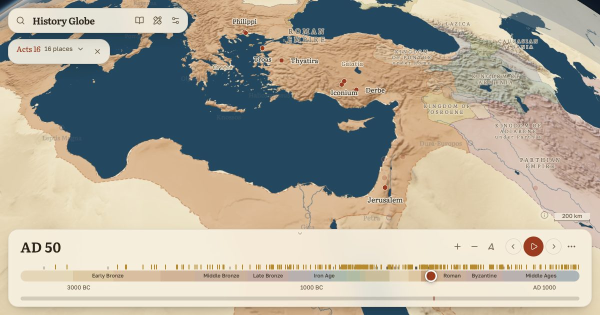

# History Globe

[](https://historyglobe.app)

**[historyglobe.app](https://historyglobe.app)** is a free 3D atlas of biblical history. A time
slider moves the map through the centuries: state borders by year, cities in the years they
stood, roads, journeys and battles. Each place has the verses that name it, its candidate
sites when the identification is disputed, where it is today, and, for 746 of them, an
article with its sources. The site has no accounts, no ads and no fees. It is made by Vadym Arnaut.

[Open the globe](https://historyglobe.app) ·
[Methodology](https://historyglobe.app/docs/methodology.html) ·
[API](https://historyglobe.app/docs/api.html) ·
[Dataset](https://huggingface.co/datasets/ArVaViT/history-globe) ·
[How to cite](#how-to-cite) · [Changes to the data](CHANGELOG.md)

## What it holds

As of the release of 2026-11-20 (`api/v1/index.json`, `built_at`):

- 21 languages: English, Russian, Ukrainian, Spanish, Portuguese, German, French, Italian,
  Dutch, Polish, Czech, Swedish, Norwegian Bokmål, Danish, Tagalog, Serbian, Hungarian, Finnish,
  Vietnamese, Romanian and Bulgarian. No language
  comes first (ADR 0015).
- 1,231 places named in the Bible, each with its verses and a page of its own (1,288 place
  records in all); 746 place articles and 200 answered questions.
- 62 tours, 329 dated events and 60 battles.
- 2,994 people (STEPBible TIPNR) in the open data; 2,153 of them with their families on the
  map.
- 773 notes on what ancient authors wrote about 439 of the places; 1,987 places of the
  ancient world the Bible does not name; 320 photographs.
- State borders by year from 3500 BC to AD 1300 (Cliopatria, corrected for the lands of the
  Bible); Roman roads (Itiner-e).

## How it is checked

The places, verses and points come from open scholarly datasets (OpenBible.info, STEPBible
TIPNR, Pleiades, Wikidata, Cliopatria); where we depart from them, the reason and the source
are given. The
articles, tours and events are drafted by the author with the assistance of large language
models and then checked against their sources in separate review passes. The last full pass,
finished on 2026-10-17, re-read every article against its sources. These passes are the
project's own checks, not peer review. Reviews by specialists are published under their names:
an article a specialist has reviewed names the reviewer and links to the review (Juan Manuel
Tebes has reviewed five articles on Edom and the Arabah); every other article page says it has
not been read by a historian yet. How each layer is made and
what is uncertain: [methodology](https://historyglobe.app/docs/methodology.html).

Errors we found in the datasets we draw on, and our own disagreements with them, are listed
with their evidence in [`docs/crosswalk/their-errors.md`](docs/crosswalk/their-errors.md).

## Links

- Site: <https://historyglobe.app>
- Methodology: <https://historyglobe.app/docs/methodology.html>
- Sources and credits: <https://historyglobe.app/docs/sources.html>
- Open API (static JSON, no key): <https://historyglobe.app/api/v1/>, documented at
  <https://historyglobe.app/docs/api.html>
- What you may build on it: <https://historyglobe.app/docs/build.html>
- Dataset on Hugging Face: <https://huggingface.co/datasets/ArVaViT/history-globe>
- Crosswalk to OpenBible, Wikidata, Pleiades, TIPNR and Theographic:
  [`docs/crosswalk.md`](docs/crosswalk.md)

## Licences

| What                                                 | Licence                             |
| ---------------------------------------------------- | ----------------------------------- |
| The data (places, names, tours, events, people, API) | CC BY 4.0                           |
| The place articles and the answered questions        | CC BY-NC-ND 4.0                     |
| The code, the site and its design                    | all rights reserved; public to read |

Third-party data keeps its own licence (`docs/ATTRIBUTIONS.md`). Details: `LICENSE`, ADR 0014
and ADR 0016.

## How to cite

As the methodology gives it (https://historyglobe.app/docs/methodology.html#cite); the date of
the data is `built_at` in api/v1/index.json, also at the foot of every documentation page.

The site:

```text
Arnaut, Vadym. History Globe: an atlas of biblical history. https://historyglobe.app/
(data of <built_at>; accessed …).
```

A page, by its title and address:

```text
“Jerusalem.” In Vadym Arnaut, History Globe. https://historyglobe.app/en/place/jerusalem/
(data of <built_at>; accessed …).
```

The data, by the date of the snapshot that the dataset's card gives (its version), with the
BibTeX entry on the card:

```text
Arnaut, Vadym. History Globe dataset. Hugging Face, snapshot of ….
https://huggingface.co/datasets/ArVaViT/history-globe. CC BY 4.0.
```

`CITATION.cff` has the same in machine-readable form. What changed in the data from one
release to the next: [`CHANGELOG.md`](CHANGELOG.md).

## Contact

historyglobe.vadym@gmail.com — corrections, reviews, questions and security reports
(`SECURITY.md`). A correction can also be filed as a GitHub issue ("Report an error"); an
email needs no account.

---

## For developers

Requirements: Node 24.11+, pnpm through corepack (the version is pinned in `package.json`),
Python 3.11+ with its standard library only. No account or key is needed to build, run or
test the site.

```sh
corepack enable  # pnpm as pinned in package.json
pnpm install
pnpm data        # downloads the open datasets (some 260 MB, minutes) and builds apps/web/public/data
pnpm content     # the static pages, the open API and the documentation pages
pnpm dev         # http://localhost:5173
pnpm gate        # everything that must pass before a merge
```

`pnpm gate` runs format, lint, types, unit and pipeline tests, the content checks, links, the
build, the CSP hashes and the JS budget. CI runs the part of it that needs no data on every
pull request; the whole gate runs locally before a merge, and releases are deployed prebuilt
(ADR 0012). What the data and content checks refuse, and why: `docs/data-checks.md`. The
browser checks: `e2e/README.md`. How to contribute: `CONTRIBUTING.md`.

Keys in the app: `[` `]` move the year by 10 (with Shift by 100), Space plays, `/` searches,
`←` `→` step through a tour, `N` turns north up, Esc closes.

### Environment

Nothing is read from a `.env` file; every variable is optional.

| Variable                               | Read by                                                           | Without it                                        |
| -------------------------------------- | ----------------------------------------------------------------- | ------------------------------------------------- |
| `SITE_URL`                             | `scripts/build-pages.ts`, `build-docs.ts`, `build-page-hashes.ts` | no canonical links and no sitemap                 |
| `HG_URL`                               | `e2e/`                                                            | the browser checks open `http://localhost:5173/`  |
| `HG_TILES=live`                        | `e2e/browser.mjs`                                                 | the relief is one flat tile served locally        |
| `CHROMIUM`                             | `e2e/browser.mjs`                                                 | Playwright's own Chromium                         |
| `TEXT_PLACES_DEBUG`                    | `scripts/build-text-places.ts`                                    | the dropped name matches are not written out      |
| `HG_CANARY_SEED`, `HG_CANARY_REGISTRY` | `scripts/canary.ts` (ADR 0017)                                    | no canary marks; for the official site only       |
| `WEBMCP_ORIGIN_TRIAL`                  | `apps/web/vite.config.ts`                                         | no origin-trial token; for the official site only |
| `DATABASE_URL`                         | `db/load.sh`                                                      | the optional database load cannot run             |

Deploying the official site, loading its database and publishing the dataset need the
maintainers' credentials; none of it is needed to work on the code or the content.

### Principles

- **Every fact has a source**; disputed things are shown as disputed, with named proponents.
- **Scripture speaks for itself.** The Bible is a separate layer, never pulled into
  scholarly disputes.
- **Clean data provenance.** The data we take in is public domain, CC0 or CC BY only;
  nothing share-alike or non-commercial (ADR 0008).
- **Decisions that are expensive to reverse are recorded** in `docs/adr/`; a change of mind
  is a new record.

### Docs

- `AGENTS.md` — rules for coding agents (and humans).
- [`docs/adr/`](docs/adr/README.md) — architecture decisions, with their index and status.
- `docs/content-guide.md` — how articles, tours, events and the years of towns are written.
- `docs/data-checks.md` — what the build refuses, and why.
- `docs/data-release.md` — the data release, file by file; `db/` — the same as a database.
- `docs/adding-a-language.md` — what a new language needs.
- `docs/embed-protocol.md` — the iframe contract with host pages.
- `docs/crosswalk.md` — the crosswalk to other gazetteers.
- `docs/ATTRIBUTIONS.md` — third-party data and credits.
